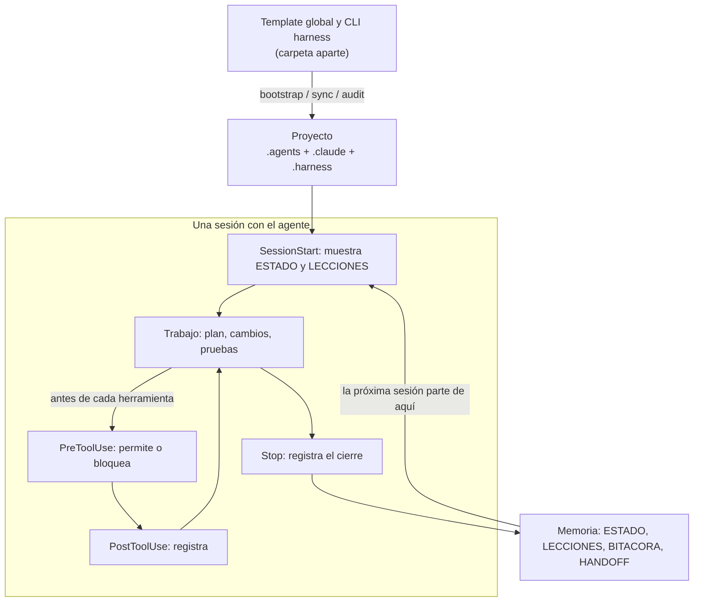

# Reservas de eventos y servicios

Sitio web para registrar eventos y ofrecer servicios en línea. El usuario elige un evento o servicio, deja sus datos y recibe un comprobante de reserva con su código, sus datos y el total. Pensado para Santa Cruz de la Sierra, Bolivia: los precios se muestran en bolivianos (`Bs 1.500`).

**Stack:** Python + Flask + SQLite (backend) y HTML/CSS/JavaScript puro (frontend, sin compilación ni dependencias). Flask sirve ambos.

Este repositorio tiene **dos partes**: la aplicación y la **arquitectura de agentes** con la que se desarrolla y se mantiene (reglas, memoria, hooks, permisos y verificación). La segunda está explicada en [Arquitectura de agentes](#arquitectura-de-agentes).

```
backend/      API Flask + SQLite (app.py, tests/)
frontend/     index.html (catálogo y reserva), comprobante.html, admin.html
CLAUDE.md     punto de entrada del agente: importa las reglas y el traspaso
AGENTS.md     copia generada de .agents/AGENTS.md (no se edita)
HANDOFF.md    traspaso: cómo correr, estado real, próximos pasos, preguntas abiertas
.agents/      reglas, memoria, hooks, permisos, skills y pruebas de los hooks
.claude/      configuración de Claude Code: permisos y conexión de los hooks
.harness/     evidencia: auditorías, reportes de ciclos y propuestas
```

## Arrancar

Desde `backend/`:

```powershell
python -m venv venv
.\venv\Scripts\Activate.ps1
pip install -r requirements.txt
if (-not (Test-Path .env)) { Copy-Item .env.example .env }
python app.py
```

Abre http://127.0.0.1:5000. Panel de administración: http://127.0.0.1:5000/admin.html.

Define `ADMIN_TOKEN` en `backend/.env`; si lo dejas vacío, se genera un token temporal y se imprime en la consola. Con `SEMILLA_DEMO=1` (por defecto) se cargan 3 eventos de ejemplo si la base está vacía.

## Cómo se usa

- **Usuario:** elige un evento o servicio, completa nombre, documento, teléfono, correo y cantidad, y confirma. Se abre su comprobante, que puede imprimir o guardar como PDF. Para volver a verlo: "Mi comprobante" con el código y el correo.
- **Administrador:** entra a `/admin.html` con el token. Ve un resumen (reservas, total reservado, publicados y cupos libres), registra y edita eventos o servicios, ajusta cupos, oculta o publica, y busca entre las reservas recibidas. Si cambia un precio, los comprobantes ya emitidos no cambian.

## API

| Método y ruta | Quién | Qué hace |
|---|---|---|
| `GET /api/eventos` | público | Lista lo publicado |
| `GET /api/eventos/<id>` | público | Detalle |
| `POST /api/reservas` | público | Crea la reserva y devuelve el comprobante (201) |
| `POST /api/reservas/consultar` | público | Devuelve el comprobante si el código y el correo coinciden |
| `GET/POST /api/admin/eventos`, `PUT /api/admin/eventos/<id>` | admin | Lista, registra y edita |
| `GET /api/admin/reservas` | admin | Lista las reservas |

Las rutas de admin exigen el encabezado `X-Admin-Token`. Errores: `{"error": "...", "campos": {...}}` con 400 (validación), 401, 404 o 409 (sin cupos o evento ya ocurrido).

## Reglas

- Los cupos se descuentan de forma atómica; nunca quedan negativos.
- No se reserva un evento pasado u oculto. Máximo 10 por reserva.
- El comprobante conserva los datos del evento y el precio del momento de la reserva.
- El correo no viaja en la URL (la consulta es `POST`), para que no quede en los logs.

## Arquitectura de agentes

El proyecto se desarrolla con un agente de IA ([Claude Code](https://claude.com/claude-code)) dentro de un **harness**: un conjunto de archivos de texto que le dicen qué reglas seguir, qué recordar entre sesiones, qué puede hacer sin preguntar y cómo comprobar su propio trabajo. Todo está en el repositorio para poder leerlo, revisarlo y versionarlo.

### Tres capas

1. **Template global (fuera de este repositorio).** Una carpeta con un `template/` canónico y una CLI en Python sin dependencias, `harness`, con tres comandos: `bootstrap` (crea un proyecto nuevo), `sync` (trae las novedades del template sin pisar lo personalizado) y `audit` (revisa el estado de todos los proyectos). Un `manifest.json` da a cada archivo un modo:
   - `managed`: viene del template y `sync` lo actualiza, salvo que el proyecto lo haya personalizado.
   - `seed`: se copia una sola vez (memoria, traspaso, reglas) y nunca se pisa.
   - `generated`: copia derivada de otro archivo, se regenera siempre y no se edita.
2. **Proyecto (este repositorio).** Lo que el template instaló y el proyecto fue completando: `.agents/`, `.claude/`, `.harness/`, `HANDOFF.md` y `CLAUDE.md`.
3. **Sesión.** Al abrir el proyecto, Claude Code lee `CLAUDE.md`, que importa `.agents/AGENTS.md` (reglas) y `HANDOFF.md` (traspaso). Desde ahí los hooks acompañan cada paso.



### Las seis dimensiones

| Dimensión | Archivo | Qué contiene |
|---|---|---|
| 1 y 2. Herramientas y APIs | `.agents/TOOLS.md` | Solo lo que el agente usa de verdad, con evidencia; binarios necesarios; APIs externas (ninguna) |
| 3. Memoria | `.agents/memory/` y `HANDOFF.md` | Lo que se recuerda entre sesiones (ver abajo) |
| 4. Archivos | `.agents/AGENTS.md` | Reglas del proyecto y mapa del harness. Es la fuente; el `AGENTS.md` de la raíz es su copia generada |
| 5. Permisos | `.agents/PERMISSIONS.md` y `.claude/settings.json` | Tres niveles y su aplicación |
| 6. Entorno de ejecución | `.agents/RUNTIME.md` y `.agents/hooks/` | Sistema operativo, shells, servidor, comandos de prueba y verificación de hooks |

### Memoria

| Archivo | Para qué | Ritmo |
|---|---|---|
| `.agents/memory/ESTADO.md` | Foco actual y próximo paso | Se reescribe cada sesión |
| `.agents/memory/LECCIONES.md` | Correcciones que no hay que repetir, en imperativo: "Cuando..., haz..., porque..." | Solo se agrega |
| `.agents/memory/BITACORA.md` | Historia: una línea por sesión | Solo se agrega |
| `HANDOFF.md` | Traspaso para quien llegue después: cómo correr, qué funciona y cómo se verificó, próximos pasos | Se actualiza al cerrar |
| `IDENTIDAD.md` y `PREFERENCIAS.md` | Quién es el agente y cómo prefiere trabajar la persona | Se mantienen **locales**: son borradores sin confirmar y no se publican |

### Hooks

Cuatro eventos de Claude Code, cada uno con su script en `.agents/hooks/`, en `.sh` (Git Bash, Linux y macOS) y en `.ps1` (PowerShell, conectado desde `.claude/settings.windows.json`):

| Evento | Qué hace |
|---|---|
| `SessionStart` | Muestra al agente el ESTADO y las LECCIONES, y avisa si quedan archivos del harness con TODO |
| `PreToolUse` | Registra la llamada y **bloquea** las que tocan archivos de secretos o son destructivas. También bloquea una entrada vacía. Revisa el texto crudo, sin depender de `jq`, para no fallar abierto |
| `PostToolUse` | Registra la llamada; tras escribir o editar, recuerda actualizar el ESTADO |
| `Stop` | Registra el cierre y deja en la bitácora una línea para completar |

Los hooks escriben en `.agents/hooks.log` (local, no se versiona). `.agents/tests/test-hooks.sh` los prueba: un hook roto rompe todas las sesiones.

### Permisos en tres niveles

Se aplican con `.claude/settings.json` (`allow`, `ask`, `deny`) y, como segunda barrera, con el hook `PreToolUse`.

- **Verde, sin preguntar:** leer, listar y buscar; `git status`, `git diff` y `git log`; pruebas y lint locales.
- **Amarillo, preguntar siempre:** instalar dependencias, `git push`, publicar o desplegar, usar contenedores.
- **Rojo, bloqueado:** borrados masivos, reinicios destructivos del historial, push forzado, leer o imprimir archivos de secretos y escanear sistemas ajenos.

Cuando una regla pasa de "preguntar" a "permitir", se justifica por escrito en `PERMISSIONS.md`. El caso documentado son las pruebas y el lint locales.

### Ciclo de trabajo

**Pensar** (plan de 3 líneas) → **Actuar** (el cambio más chico que resuelve la tarea) → **Verificar** → **Repetir** si falla → **Aprender** (una lección en `LECCIONES.md`). Cada ciclo deja un reporte en `.harness/reportes/`. Verificar son cuatro capas que no se reemplazan entre sí: pruebas, lint, `harness audit` y revisión del cambio. La regla de fondo: no declarar "verificado" lo que no se pudo ejecutar; se escribe "no verificado" y por qué.

### Skills del proyecto

Viven en `.agents/skills/`:

- `ciclo-de-mejora`: guía el ciclo anterior y deja la lección escrita.
- `verificar-sitio`: pruebas, lint, un humo con el servidor real (`humo.sh` arranca la app con una base temporal y revisa las rutas clave) y la revisión de la interfaz en el navegador.

### Evidencia

`.harness/auditorias/` guarda las salidas de `harness audit`; `.harness/reportes/` tiene un reporte por ciclo (por ejemplo, la prueba de la interfaz en Chrome); `.harness/propuestas/` está reservada para mejoras al template.

### Límites actuales

Este harness se mantiene con honestidad sobre lo que no está comprobado:

- **Template.** La CLI y el template no están en este repositorio. El proyecto no tiene el archivo de registro `.harness.json`, y una simulación de `harness sync` (2026-11-22) mostró que la versión actual del template distribuye los archivos de otra forma (carpeta `agents/` en minúscula y un hook en Python). Por eso no se aplicó, y el `AGENTS.md` de la raíz se regeneró a mano copiando lo que hace el generador.
- **Hooks en PowerShell.** Solo se probaron los `.sh` (6 pruebas OK en Git Bash). La variante de PowerShell no está verificada.
- **Hook `Stop`.** Deja una línea por turno y no una por sesión, así que hay que limpiar la bitácora a mano. Es la primera candidata para una propuesta de mejora al template.
- **Skills.** Las de `.agents/skills/` son una convención del harness; no aparecen como comandos de Claude Code a menos que se copien a `.claude/skills/`.
- **Frontend.** No tiene pruebas automatizadas; la interfaz se probó a mano en Chrome (escritorio y ancho de móvil), sin revisar el tema claro, la impresión ni un teléfono real.
- **Auditoría.** La última `harness audit` es del 2026-11-17, anterior a los cambios posteriores.
- **Memoria personal.** `IDENTIDAD.md` y `PREFERENCIAS.md` siguen sin confirmar.

## Pruebas

Desde `backend/`:

```bash
python -m unittest discover -s tests                                     # 21 pruebas del backend
python -m ruff check . --exclude venv                                    # lint de Python
for f in ../frontend/*.js; do node --check "$f" || echo "FALLA $f"; done # sintaxis del JavaScript (Git Bash)
```

Humo con el servidor real, desde la raíz (Git Bash): `sh .agents/skills/verificar-sitio/humo.sh`. Su paso de interfaz en el navegador es manual.

## Límites conocidos

Sin cuentas de usuario, pagos, envío del comprobante por correo ni cancelación de reservas. Usa el servidor de desarrollo de Flask: para producción hace falta un servidor WSGI, HTTPS y copias de seguridad de `backend/datos.db`.

## Licencia

[MIT](LICENSE).
